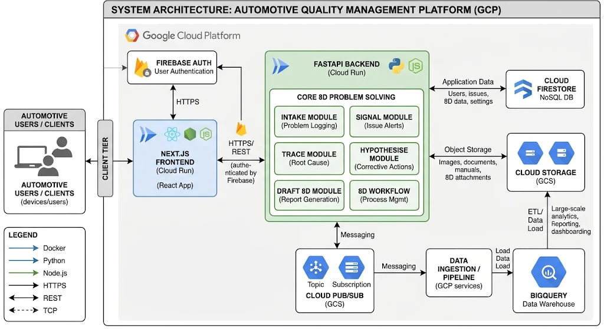
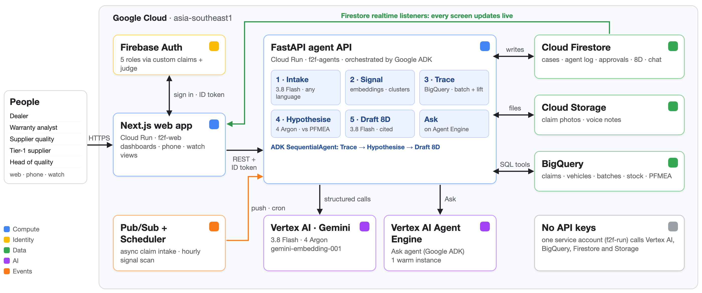

# Field-to-Fix

Warranty claims → failure clusters → supplier batch → root cause → drafted 8D, with Gemini agents on Google Cloud.
Built for the Google Cloud AI Builder Cup 2026 (Manufacturing: Intelligent Operations & Industrial Efficiency).

**Dealers file it, OEMs approve it, suppliers solve it.** Field-to-Fix reads every warranty claim in any
language, spots failure clusters early, traces them to the exact part, supplier and production batch, and
drafts the 8D corrective-action report for the supplier-quality engineer to approve.

**Team:** Deep Mandlik (team leader), Pranali Shinde

| | |
|---|---|
| Live prototype (Cloud Run) | https://f2f-web-lc64mw36wq-as.a.run.app — tick “I’m a judge” on the login page |
| Watch view | https://f2f-web-lc64mw36wq-as.a.run.app/watch |
| Demo video (3:14) | https://drive.google.com/file/d/13FqNQnWm67ml6OBLyBttgP9fU-pn3wZ5/view?usp=sharing |
| Brief description | [submission/DESCRIPTION.md](submission/DESCRIPTION.md) |

## Agents and models

- Gemini 3.8 Flash (Intake, Ask, 8D draft, supplier gap check) and Gemini 4 Argon (root cause) on Vertex AI, with low
  thinking for speed; set in `agents/f2f/config.py` (`MODEL_FAST`, `MODEL_REASON`, `MODEL_DRAFT`, `THINKING_LEVEL`).
- The Ask agent runs on Vertex AI Agent Engine (`agents/f2f_engine`, deployed by `scripts/deploy_agent_engine.py`;
  set `AGENT_ENGINE` to its resource name). Without it, Ask runs the same ADK agent in-process.
- Orchestration uses the Google Agent Development Kit (`agents/f2f/adk_agents.py`): the investigation is a
  `SequentialAgent` of Trace → Hypothesise → Draft 8D, and Ask is an `LlmAgent` with case tools. If ADK is not
  installed or fails before a step runs, both fall back to the direct Gen AI SDK path. `USE_ADK=0` forces that path.

## Hard intake test

`agents/eval/hard_notes.py` holds 100 hand-written messy notes (typos, Hinglish, slang, two-word notes, mixed
Bahasa/English). Run it from `agents/`:

```bash
python -m eval.run_hard_eval
```

Results with Gemini 3.8 Flash: 99/100 (default thinking) and 100/100 (low thinking, the setting the app uses); see `agents/eval/hard_results.json`.

## Architecture



In detail, as deployed (Google ADK orchestration, Gemini 3.8 Flash and 4 Argon, Ask on Vertex AI Agent Engine):



```
Dealer / Analyst / SQE / Supplier / Exec
        │  Firebase Auth (role claims)
        ▼
Cloud Run: f2f-web (Next.js) ──realtime──▶ Firestore (cases, events, 8D, chat)
        │ REST + ID token                      ▲
        ▼                                      │
Cloud Run: f2f-agents (FastAPI, orchestrated by Google ADK) ──┘
   ├─ 1 Intake      Gemini 3.8 Flash: multilingual note + photo + voice → structured claim + embedding
   ├─ 2 Signal      HDBSCAN on gemini-embedding-001 vectors, growth vs baseline, Gemini names clusters
   ├─ 3 Trace       BigQuery: VIN → plant → part → supplier → batch, lift vs fleet share, stock
   ├─ 4 Hypothesise Gemini 4 Argon + PFMEA/control-plan retrieval, cited root causes
   ├─ 5 Draft 8D    Gemini 3.8 Flash, D2–D5 with citations validated against inputs
   └─ Ask          ADK agent on Vertex AI Agent Engine, scoped to one case
        │
        ├─ BigQuery  (claims, vehicles, vin_parts, batches, stock, pfmea_rows, control_plan_rows)
        ├─ Cloud Storage (photos, voice notes)
        └─ Pub/Sub claims-new → /pubsub/claims (async intake) · Cloud Scheduler → /signal/run
```

No API keys: Cloud Run calls Vertex AI, BigQuery, Firestore and Storage as service account `f2f-run`.

## Run locally

```bash
# 1. Python env (3.12) and data
cd agents && uv venv -p 3.12 && source .venv/bin/activate && uv pip install -r requirements.txt
cp .env.example .env
cd .. && python scripts/gen_data.py && python scripts/load_bq.py
python scripts/seed_users.py           # demo accounts, passwords in .env.demo

# 2. API
cd agents && uvicorn main:app --reload --port 8080

# 3. Web
cd web && cp .env.local.example .env.local   # fill Firebase web config
npm install && npm run dev                    # http://localhost:3000
```

## Deploy

See `scripts/deploy.sh`. Both services deploy to Cloud Run in asia-southeast1.

## Demo script (3 min)

1. Analyst → **Run signal scan** → "Coolant leak at hose clamp", 3×+ baseline.
2. **Investigate with agents** → live progress: trace to Kaveri Hoses batches KAV-26W31/32, 6× lift,
   Dzire-S VINs at risk with zero claims yet; PFMEA R-14 (clamp torque) + control-plan CP-06 (1-in-50 audit).
3. Switch to SQE → 8D tab → edit, **Approve and send to supplier**.
4. Switch to Supplier → respond → AI completeness check flags gaps.
5. Dealer view → Hindi note → **Fill fields with AI**.

Data is synthetic: 6,400 vehicles, 630 claims in English, Hindi and Bahasa Indonesia, one planted cluster.
